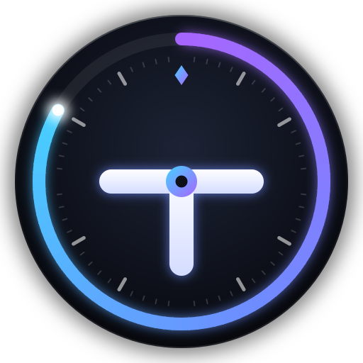
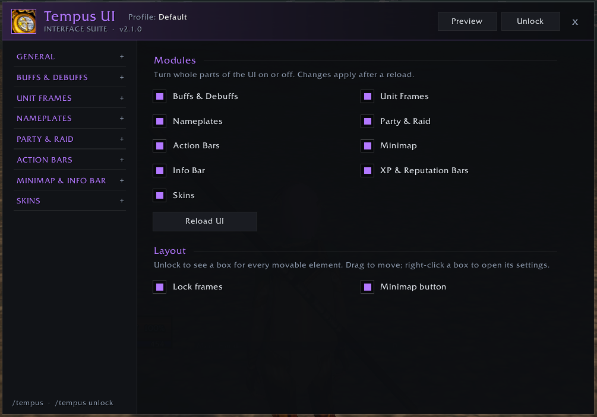
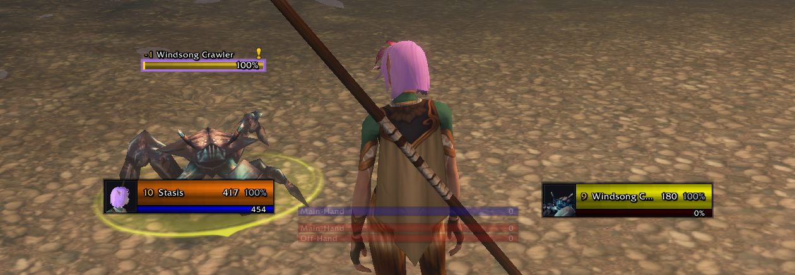
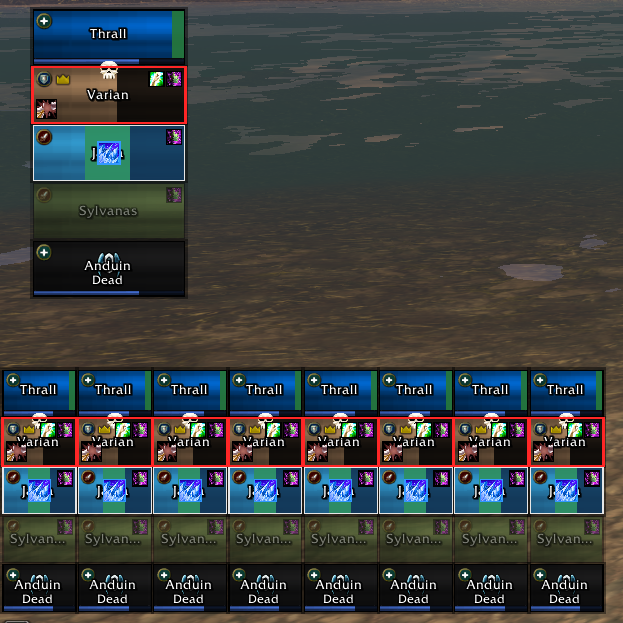
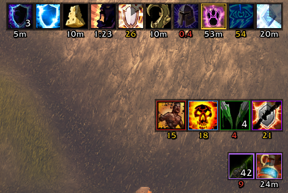
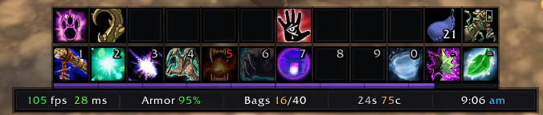
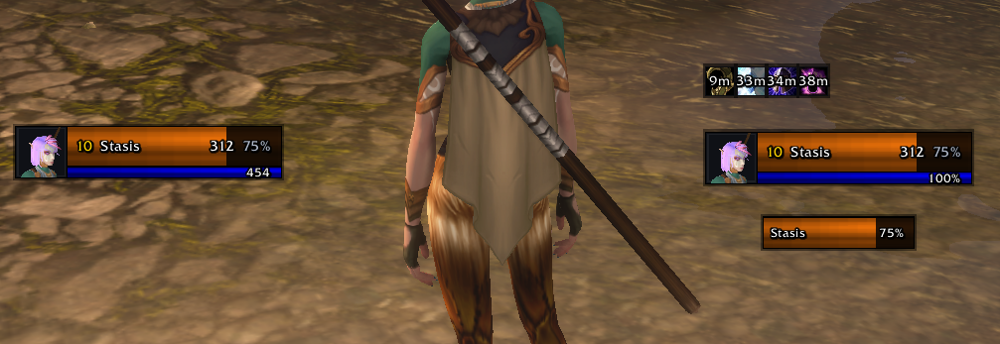

<h1 align="center">Tempus UI</h1>

A complete World of Warcraft interface in one clean look: buff timers, unit frames, nameplates, party and raid frames, action bars, searchable combined bags, a square minimap, an info bar, a combat strip (Combat Pulse), and skins for Blizzard's windows. Every part is a module you can turn off.

Built for the new Classic client (interface 16001), where the game hides health, auras and range from addons in combat. Tempus is written around that: hidden values go straight from the game into bars, text and colours, and auras are drawn by the game's own aura containers, so everything keeps updating mid-fight.

## Screenshots

| Nameplates | Party & raid frames |
|---|---|
|  |  |
| **Buffs & debuffs** | **Action bars & info bar** |
|  |  |
| **Unit frames** | |
|  | |

## Modules

- **Buffs & Debuffs**: icon or bar timers, a watch list for buffs you never want to forget, expiry warnings, click to recast or cancel.
- **Unit Frames**: player, target, target-of-target and pet, with cast bars, portraits, combo points and live target auras.
- **Nameplates**
  - Colours for threat (tank or damage role), execute range, class and reaction.
  - Con at a glance: a coloured strip, relative level (+3 / -2), elite pips or a 1-5 danger rating; grey mobs shrink and fade.
  - Cast bars that show when a cast can be interrupted, your own interrupt with its cooldown, and who stopped a cast.
  - Alerts for spells on your watch list, and a purple edge on enemies carrying a buff you can dispel or steal.
  - Your debuffs, purgeable buffs and crowd control.
- **Party & Raid**
  - Healer-ready frames: range fading, incoming heals and absorbs, and dispellable debuffs with a coloured tint.
  - Your HoTs with timers, role and leader icons, aggro borders, and a raid grid for up to 40.
  - Built-in click-casting with starting bindings for Druid, Priest, Shaman and Paladin; Clique also works.
  - Mouseover keybinds: hover a frame and press a key (up to 8 per class) to cast on that player, in combat too.
  - Drag the corner grip on an unlocked party or raid box to resize the frames, or pick a Compact, Standard or Large preset.
  - Party and raid frames can list tanks and healers first.
- **Cooldowns**: a row of icons with cooldown swipes for spells you pick, plus your trinkets.
- **Combat Pulse**: one compact strip that gathers the fight. The layered DPS bar from Blizzard's damage meter (live, your peak, group top) and a thin swing line, plus small cues that appear only when they matter: an interruptible target cast (with your interrupt's cooldown), a buff you can purge, threat trouble and the execute range. Three modes: **Minimal** (urgent cues only), **Standard** (DPS, swing and cues) and **Full** (everything, including peak and group top numbers). Each signal can be switched off; the threat role and execute threshold follow the Nameplates settings. Swing timing needs the Swing timer module. A test mode shows every cue out of combat.
- **Vendor**: sells grey items and repairs gear when a merchant opens.
- **Bags**: combines carried bags and personal bank storage, with instant multi-word search, native item interactions, quick filters for gear, consumables, trades, quests and junk, a bag bar, item level and upgrade marks, cooldowns, a gold and currency footer, and grid or automatic category views with foldable sections and your own custom categories. It also remembers every character's bags and bank: the **Alts** button browses them, even offline, and item tooltips show what your other characters hold. If another bag addon is enabled, Tempus asks which one should own the bags for that character.
- **Profiles**: share your settings as a text string (Export / Import on the Profiles page).
- **Action Bars**: restyled bars with fading, hotkeys and range colouring, plus a movable, restyled micro menu and bag buttons.
- **Minimap, Info Bar, XP & Reputation Bars**: a square minimap and a configurable info bar. The Tempus button sits in the map's lower right corner: left-click opens settings, right-click opens the tray of addon buttons. Addon minimap buttons can stay on the edge, fade until mouseover, or collect in that tray.
- **Chat**: a select mode (Alt+click a window) that lets you select and copy chat like a text editor, arrow keys that move the cursor in the chat box, clickable web links, a copy window, chat history that survives a reload, timestamps and tabs that fade until mouseover, on top of Blizzard's chat (secret-value safe).
- **Skins**: Blizzard windows, tooltips, chat, and Bagnon and DBM. Includes a quest log search and a fully skinned quest tracker. **Stock skin** keeps the search but leaves Blizzard's own look in place.

## Themes

The accent colour recolours the settings window, move boxes and bags at once (some Blizzard skins need a reload). The Theme setting (Style Studio) restyles every Tempus panel and status bar live: **Modern** (crisp edge and soft shadow), **Gloss** (adds a glassy highlight), **Classic** (a warm Blizzard-style border; skinned windows keep Blizzard's own frames after a reload) and **Flat** (no decoration). Class, dispel and target highlight edges stay visible in every theme.

**General > Style Studio** brings sample player and target frames, enemy nameplates, buffs, debuffs, action buttons and cast bars together. Change the shared theme, texture, font, outline, accent or icon crop while the scene runs, or pause it to compare details. These controls save immediately; the scene uses simulated data and does not enable module test modes. Samples demonstrate the shared appearance at fixed sizes, rather than your screen layout.

Every settings page has a live preview. Unlock the UI to drag any element into place; sample frames fill the boxes so you can arrange group frames while solo.

## Auction values

With Auctionator enabled, **Convenience > Auction values** adds its last scanned per-item price and data age to item tooltips, plus stack estimates in Tempus bags. At an auctioneer, open the AH and click **Scan bag items** to search your carried item names through Auctionator. Use Auctionator's Full Scan for broader coverage. Unknown prices stay unknown and older prices are marked stale. These are listing estimates, not guaranteed sale prices.

## Install

Copy the `Tempus` folder into `World of Warcraft/_classic_/Interface/AddOns/` (or the folder for your client), then log in. The first-run setup picks modules, UI scale and a layout preset.

## Commands

| Command | What it does |
|---|---|
| `/tempus` | Open settings |
| `/tempus unlock` / `lock` | Show / hide the boxes for dragging elements |
| `/tempus install` | Run the first-run setup again |
| `/tempus test` | Preview buff displays with sample auras |
| `/tempus safe` | Turn off everything except buffs and reload (escape hatch) |
| `/tempus debug` | Show aura status and the last error |
| `/tempus log` | Show recent Lua errors and blocked-action messages |
| `/tempus perf` / `cpu` | Report time spent per Tempus feature |
| `/tempus skinreport` | Record the window under the mouse for skin fixes |
| `/tempus help` | List commands |

The settings window also has a **What's new** page with the changelog.

## Notes

- Tempus nameplates stay off while Plater or another nameplate addon is loaded.
- Settings are stored per profile in `TempusDB`. Saved character inventories are shared by every profile.
- Combat Pulse and the hidden combat values on WoW Forever:
  - Combat DPS and group top can arrive as hidden values that can be drawn but not compared. Your peak and the bar's saved scale only update from readable readings, usually just after a fight ends. Until the scale is known, the bar is drawn against the group top. The meter's in-combat value is a running average, so early-fight bursts can run past an Auto scale; set Bar scale to Fixed maximum to choose where the bar ends.
  - Whether the target's cast can be interrupted, and its health for the execute cue, are also hidden in combat. The game decides those cues' visibility, so the execute skull has no idle state, and the kick icon rests dim (Full mode) only when the target is not casting.
  - Kick readiness is shown only when your interrupt's cooldown is readable. Purge looks only for buffs your class can dispel or steal. Threat is not shown against players.

## License

Copyright (c) 2026 Allison Bayless. All rights reserved. You're welcome to download and play with Tempus UI; copying, re-uploading or reusing its code or artwork needs permission. See [LICENSE](LICENSE).

## Frame positioning and layout presets

Use `/tempus unlock` for labeled drag handles, a frame selector, arrow nudges,
edge/center snapping and alignment guides. Hold Alt for free dragging.
Open **Layout > Layout presets** to save, duplicate, rename, preview and apply
position-only layouts, or preview and restore default positions. Undo/Redo in the
positioning panel and Layout presets page recover the last 50 position changes
per profile during the current session. Shift-click frames or toggle them in the
selector to edit a group: drag/nudge together, align edges or centers, distribute
equal gaps, or center the group on screen. Each group operation is one undo step.
See [the complete layout guide](docs/layouts.md) for controls, safeguards, storage
and testing instructions.

## Automatic layouts and settings search

Under **Layout > Automatic layouts**, optionally assign saved presets to solo,
party and raid play. Switching waits for combat to end and editing to finish.
Manual adjustments take precedence for the current group type; Pause keeps manual
control across group changes. The feature is off by default.

The sidebar's **Search settings...** box finds labels and help across settings
pages. Click a match to open and highlight its control; Enter opens the first
result, and Escape clears the search.

See [setup, behavior and testing](docs/automatic-layouts-and-search.md).

While settings is open, **Escape** ends active previews first and keeps Tempus
open; press it again to close settings. The close button closes immediately.

## Optional SpellPower integration

SpellPower remains visible in the left menu when it is missing or disabled, with
a grey entry. Hover for its chat spell-checking/grammar description and
[CurseForge link](https://www.curseforge.com/wow/addons/spellpower). Right-click
the entry to open a selected, copyable URL (Ctrl+C). Install or enable SpellPower
and reload to access its settings; Tempus works without it.
